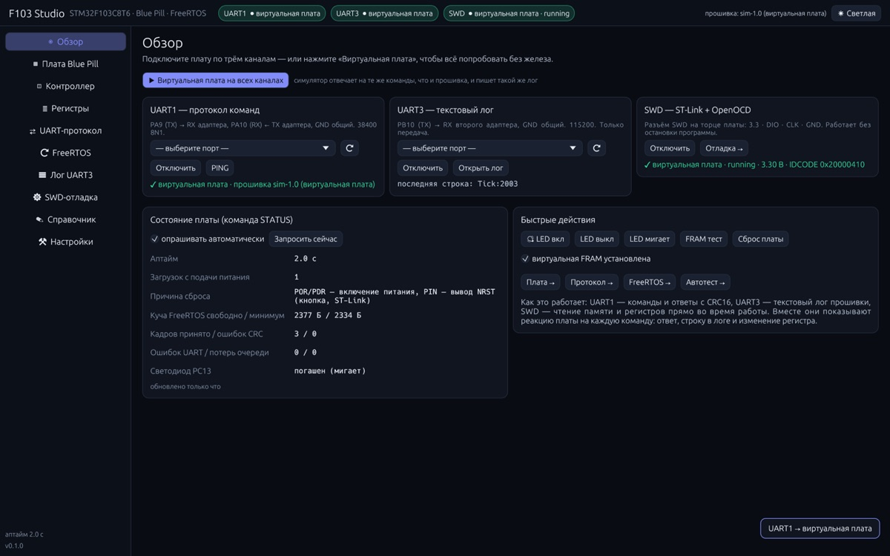

# Pill Studio — primGPT для Blue Pill и Black Pill

Прошивка **primGPT** на FreeRTOS и отладочная студия **Pill Studio** для двух плат:

| Плата | MCU | Где прошивка |
|---|---|---|
| **Blue Pill** | STM32F103C8T6, Cortex-M3, 72 МГц, Flash 64 КБ, RAM 20 КБ | этот репозиторий |
| **Black Pill** (WeAct) | STM32F411CEU6, Cortex-M4F, 96 МГц, Flash 512 КБ, RAM 128 КБ | [mkurein/F411CE](https://github.com/mkurein/F411CE) |

На обеих платах одно и то же: бинарные команды по USART1 (38400, CRC16-MODBUS),
внешняя SPI-память (FRAM на Blue Pill, W25Q64 на Black Pill), текстовый лог
(USART3 / USART6, 115200), запись сбоев `g_diag`, автотест `tools/hil.py`.
Протокол общий — [docs/PROTOCOL.md](docs/PROTOCOL.md); как проверять приём по UART1
(команды, испорченные кадры, сбои линии) — [UART_TESTING.md](UART_TESTING.md). Различия плат —
[docs/HARDWARE.md](docs/HARDWARE.md) и [docs/PINOUT.md](docs/PINOUT.md).



## Быстрый старт

```bash
make -j8                                  # Blue Pill → build/primGPT.elf
.venv/bin/python tools/hil.py test        # прошить и проверить на плате
cd studio && cargo run --release          # Pill Studio
```

Black Pill: то же самое в клоне F411CE (`make` → `build/primGPT_F411.elf`), а в
Pill Studio выбрать плату в шапке (или студия сама предложит, узнав чип по SWD).

Windows и CubeIDE: [docs/guides/QUICKSTART.md](docs/guides/QUICKSTART.md),
Cursor — [docs/guides/CURSOR_BEGIN.md](docs/guides/CURSOR_BEGIN.md),
сборка студии — [studio/BUILD.md](studio/BUILD.md).
История выпусков и смена версии — [VERSION.md](VERSION.md).

## Документация

| Start here | |
|---|---|
| [docs/PROJECT.md](docs/PROJECT.md) | что за проект и в каком состоянии |
| [docs/INDEX.md](docs/INDEX.md) | карта всей документации и кода |
| [docs/TODO.md](docs/TODO.md) | что делать дальше |
| [studio/README.md](studio/README.md) | Pill Studio: экраны, подключение обеих плат |
| [AGENTS.md](AGENTS.md) | правила для AI-агентов (Claude Code, Cursor, OpenCode) |

## Структура

```text
Core/            прошивка Blue Pill (main.c, uart.c, fram.c, diag.c, crc16.c)
Drivers/         STM32F1 HAL + CMSIS
Middlewares/     FreeRTOS 10.0.1
tools/hil.py     автотест на железе, общий для обеих плат
studio/          Pill Studio — Rust + egui, macOS и Windows (ADR-014, ADR-016)
docs/            ядро документации (короткое) + guides/ notes/ lessons/
STM32F103.svd    регистры Blue Pill; STM32F411.svd — Black Pill (для студии)
primGPT.ioc      CubeMX (см. ADR-005 перед генерацией)
```

Клоны рядом на диске (так ждут ссылки `.venv` и настройки студии):

```text
ProjectSTM/
  Pill-Studio/   этот репозиторий (раньше F103C8T)
  F411CE/        прошивка Black Pill
```
