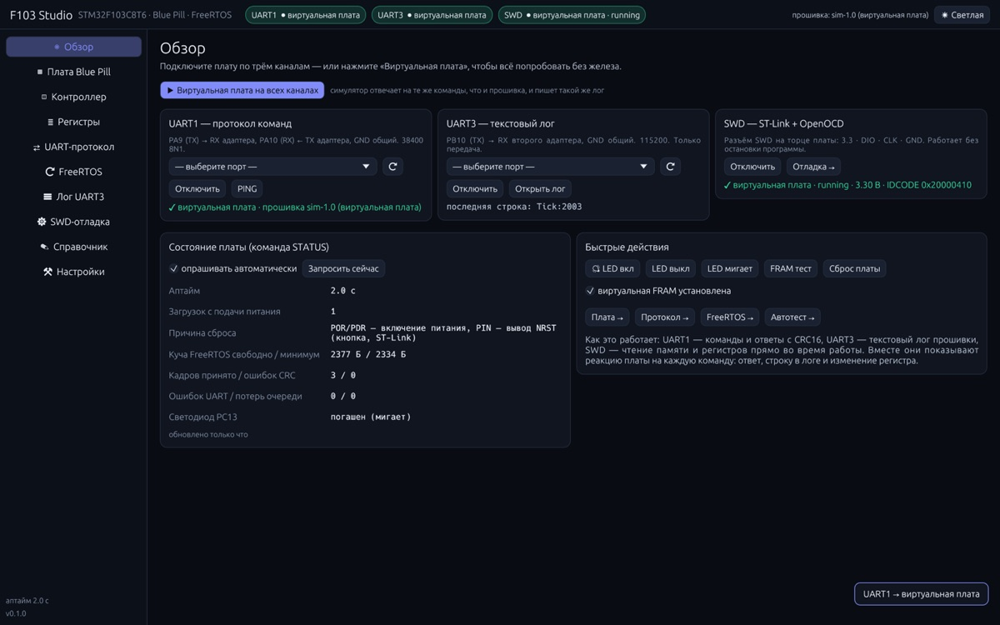
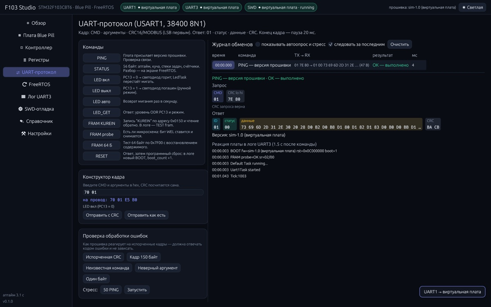

# F103 Studio

Нативная (Rust + egui) отладочная студия для прошивки **primGPT** на STM32F103C8T6
(Blue Pill) + FreeRTOS. macOS и Windows, без WebView и Node.



## Что умеет

| Экран | Что там |
|---|---|
| **Обзор** | три канала связи (UART1 протокол, UART3 лог, SWD), STATUS платы, быстрые команды, кнопка «Виртуальная плата» |
| **Плата Blue Pill** | рисунок платы по шелкографии, функции выводов этого проекта, 5 В-толерантность, живой уровень выводов по SWD |
| **Контроллер** | блоки и шины (AHB/APB1/APB2), карта памяти с занятостью из ELF, дерево тактирования + калькулятор BRR, таблица 48 выводов (DS5319 Table 5) |
| **Регистры** | все регистры из `STM32F103.svd`, поиск, живое чтение по SWD, сетка битов, запись в два шага |
| **UART-протокол** | каталог команд, конструктор кадра с CRC16/MODBUS, разбор ответа по полям, инъекция ошибок, стресс, реакция платы в логе UART3 |
| **FreeRTOS** | задачи и стеки (high-water mark), куча heap_4, счётчики, графики во времени, схема потоков данных прошивки |
| **Лог UART3** | раскраска BOOT/TEST/FAULT/DIAG, ритм `Tick` (подвисание задач видно сразу), фильтр, копирование |
| **SWD-отладка** | стоп/пуск/шаг/сброс, регистры ядра с PC → строка исходника, разбор сбоя из `g_diag` (CFSR/HFSR/BFAR), переменные по имени из ELF, сборка, прошивка, автотест `tools/hil.py`, консоль OpenOCD |
| **Справочник** | 10 коротких статей: память и запуск, тактирование, GPIO, NVIC, USART, SPI/FRAM, FreeRTOS, SWD, проверка изменений |

Без железа всё работает против **виртуальной платы**: симулятор отвечает на те же кадры,
пишет такой же лог и отдаёт правдоподобные значения регистров.

| | |
|---|---|
|  |  |
|  |  |
|  |  |

## Запуск

```bash
cd studio
cargo run --release
```

Нужен Rust ≥ 1.88 (`eframe 0.33`). Для SWD — OpenOCD в PATH (`brew install open-ocd`) или
путь к нему в «Настройках»; для «строка исходника» — `arm-none-eabi-addr2line`.

Подключение платы:

| Канал | Провода | Скорость |
|---|---|---|
| UART1 (команды) | PA9 → RX адаптера, PA10 ← TX, GND | 38400 8N1 |
| UART3 (лог) | PB10 → RX второго адаптера, GND | 115200 |
| SWD | 3.3 · DIO · CLK · GND (ST-Link V2) | — |

## Сборка дистрибутива

```bash
python3 build_macos.py              # .app + .dmg → release/vX.Y.Z/
python3 build_macos.py --universal  # arm64 + x86_64
```

```powershell
powershell -ExecutionPolicy Bypass -File build_windows.ps1   # .zip → release\vX.Y.Z\
```

## Проверки

```bash
cargo test
cargo clippy --all-targets -- -D warnings
APP_SHOTS=target/shots cargo run --release   # обход всех экранов в двух темах → BMP
```

## Устройство

```text
src/
  core/        логика без UI: proto (кадры, CRC, STATUS), svd, mcu (выводы, блоки, такты),
               openocd (TCL RPC :6667), elf (символы, секции), sim (виртуальная плата),
               link (serial), config
  worker.rs    поток ввода-вывода: Job → State + потоки (обмены, лог, выборки)
  app.rs       оболочка: навигация, статус-бар, тосты, Act → Job
  views/       экраны; получают &Shared, ставят действия в очередь
  theme.rs     палитра светлой/тёмной темы
  canvas.rs    рисование схем в координатах viewBox
```

UI никогда не блокируется: порты, OpenOCD, сборка и `hil.py` работают в потоке worker.
Протокол и раскладка `STATUS` повторяют `docs/PROTOCOL.md`; при изменении протокола
обновите `src/core/proto.rs` и `src/core/sim.rs` в том же commit.
