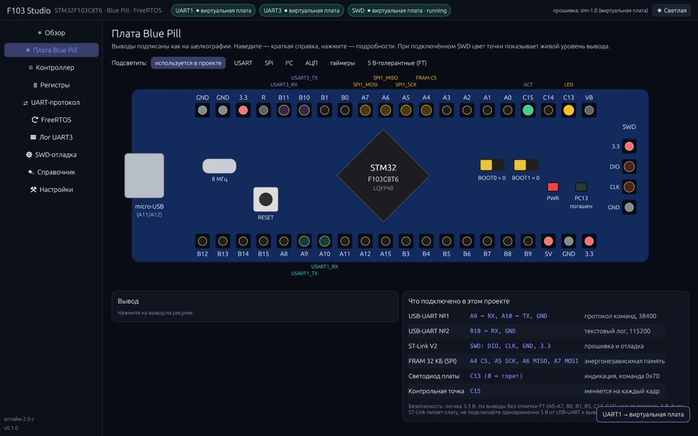
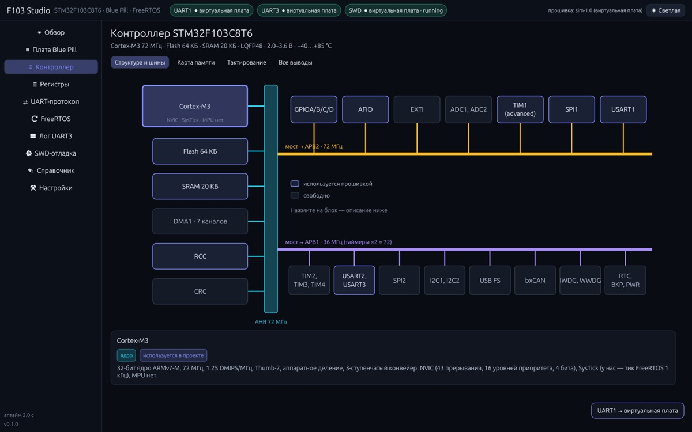
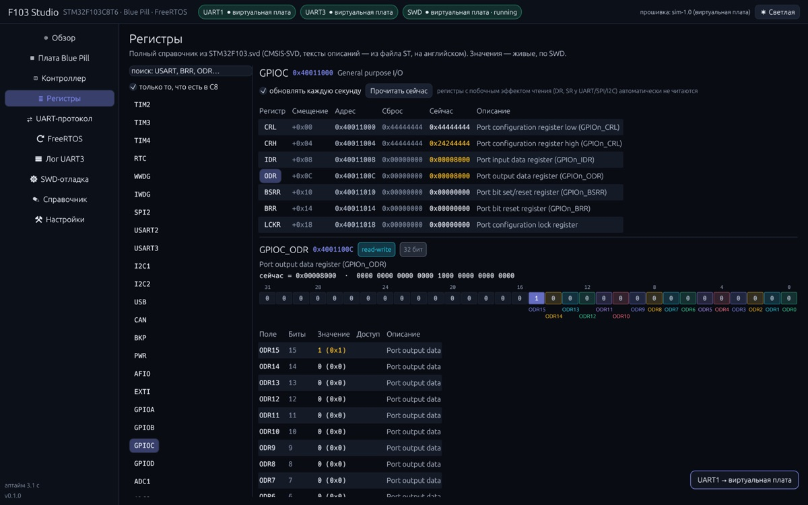
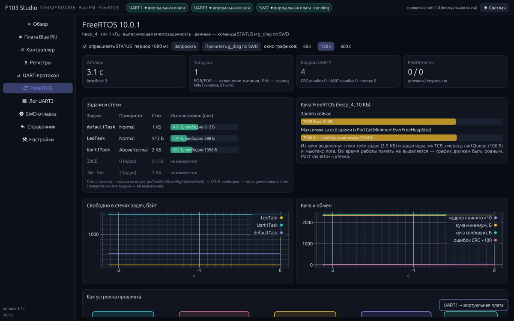
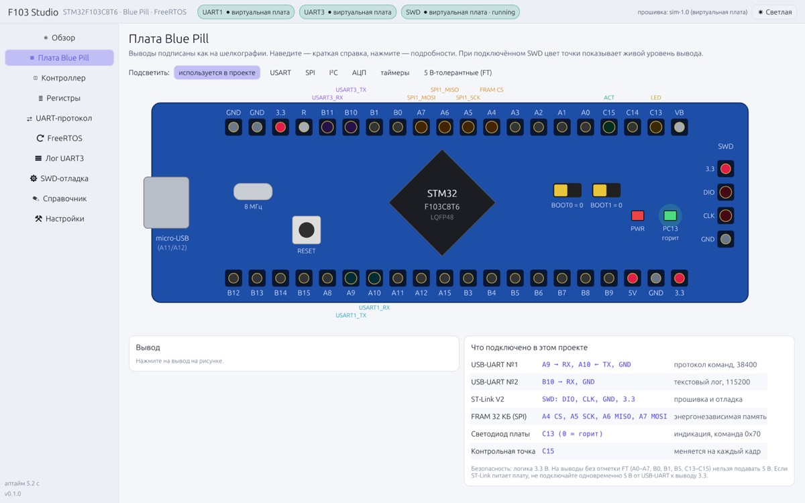
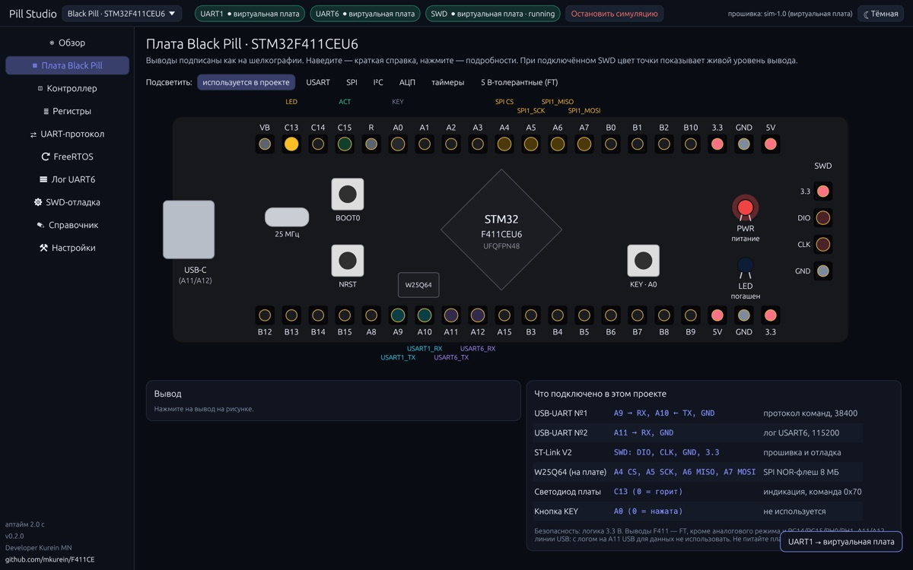
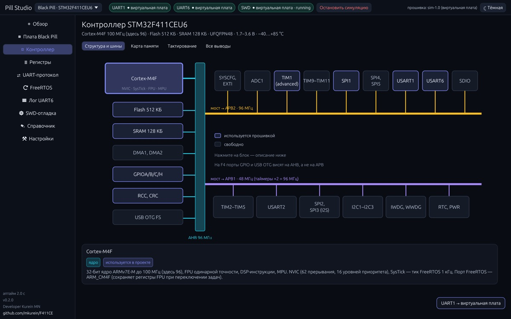

# Pill Studio

Нативная (Rust + egui) отладочная студия для прошивки **primGPT** + FreeRTOS на двух платах:
**Blue Pill** (STM32F103C8T6, этот репозиторий) и **Black Pill** (STM32F411CEU6,
репозиторий [F411CE](https://github.com/mkurein/F411CE)). Плата выбирается в шапке;
выводы, SVD, тактирование, цель OpenOCD, ELF и порты — свои для каждой (ADR-016).
macOS и Windows, без WebView и Node.


## Что умеет

| Экран | Что там |
|---|---|
| **Обзор** | три канала связи (UART1 протокол, UART3 лог, SWD), STATUS платы, быстрые команды, кнопка «Виртуальная плата» |
| **Плата** | рисунок Blue Pill или Black Pill по шелкографии, функции выводов этого проекта, 5 В-толерантность, живой уровень выводов по SWD |
| **Контроллер** | блоки и шины (AHB/APB1/APB2), карта памяти с занятостью из ELF, дерево тактирования + калькулятор BRR (PLL ×9 у F103, M/N/P/Q у F411), таблица 48 выводов (DS5319 / DS10314) |
| **Память и векторы** | карта Flash и RAM по функциям и переменным из `.map` линкера (цвет — приложение / FreeRTOS / HAL / libc; куча FreeRTOS, `g_diag`, резерв стека), самые большие куски, суммы по модулям, изменения с прошлой сборки; таблица векторов из ELF с обработчиками и живым NVIC по SWD: включено, приоритет, ожидает / выполняется, сверка с Flash платы, предупреждения (включено без обработчика, приоритет срочнее порога FreeRTOS) |
| **Старт и сброс** | причина последнего сброса по флагам `RCC_CSR` и `boot_count`, сброс командой и по SWD с проверкой, что `g_diag` его пережил; путь от вектора сброса до задач с адресами, строками исходника и размерами `.data` / `.bss` этой сборки (вызовы `main()` и задачи читаются из `Core/Src/main.c` проекта); живая трасса старта по SWD (точки останова, порядок достижения, счётчик тактов `DWT_CYCCNT`); проверка защиты (остановка задачи, assert, HardFault, имитация просадки — сторож возвращает плату, `g_diag` называет причину); что переживает сброс и потерю питания; вход в прерывание и переключение задач |
| **Регистры** | все регистры из `STM32F103.svd` или `STM32F411.svd` (только блоки, что есть в корпусе), поиск, живое чтение по SWD, сетка битов, запись в два шага |
| **UART-протокол** | каталог команд, свой кадр в hex (CRC добавить / без CRC / испортить, формат линии 8E1·8O1·7N1·другая скорость, паузы между байтами, повторы), тест надёжности из 20 сбоев кадра и линии со STATUS после каждого ([описание тестов](../UART_TESTING.md)), стресс, разбор ответов по полям, реакция платы в логе |
| **FreeRTOS** | задачи и стеки (high-water mark), куча heap_4, счётчики, графики во времени, схема потоков данных прошивки; с командой TASKS — живая таблица задач: состояние, приоритет, минимум свободного стека, доля процессора и общая загрузка; счётчики сбросов и пик очереди из `g_diag`; с командой STATS — частота прерываний (SysTick, TIM1, USART1, PVD), переключения задач и пик главного стека |
| **Лог** (USART3 / USART6) | раскраска BOOT/TEST/FAULT/DIAG, ритм `Tick` (подвисание задач видно сразу), фильтр, копирование |
| **SWD-отладка** | стоп/пуск/шаг/сброс, регистры ядра с PC → строка исходника, разбор сбоя из `g_diag` (CFSR/HFSR/BFAR), переменные по имени из ELF; активный проект прошивки (недавние и найденные рядом проекты обеих плат, любая папка; плата выбирается по линкер-скрипту), git-состояние и предупреждение «исходники новее ELF», сборка, прошивка, «Собрать и прошить», автотест `tools/hil.py`, история запусков с коммитом; консоль OpenOCD; общий OpenOCD с Cursor (GDB :3333) и переход Cursor на строку останова |
| **Справочник** | 10 коротких статей: память и запуск, тактирование, GPIO, NVIC, USART, SPI/FRAM, FreeRTOS, SWD, проверка изменений; для Black Pill — ещё «что иначе на F411» |
| **Настройки** | плата, папка проекта, команда сборки, порты и OpenOCD — отдельно для каждой платы |

Без железа всё работает против **виртуальной платы**: симулятор отвечает на те же кадры,
пишет такой же лог и отдаёт правдоподобные значения регистров.

| | |
|---|---|
|  |  |
|  |  |
|  |  |
|  |  |

## Соответствует ли экран текущей программе

Экраны «Память и векторы» и «Старт и сброс» строятся по ELF последней сборки. Вверху одна строка говорит, актуально ли это:
исходники новее ELF — «на экране прошлая сборка» и кнопка «Собрать и прошить»; Flash платы отличается от ELF (сверка по SWD,
ядро не останавливается) — «на плате другая программа» и кнопка «Прошить»; иначе — зелёная отметка. Трасса старта сбрасывается при новой сборке.

## Две платы

| | Blue Pill | Black Pill |
|---|---|---|
| Чип | STM32F103C8T6 | STM32F411CEU6 |
| Прошивка | этот репозиторий, `build/primGPT.elf` | [F411CE](https://github.com/mkurein/F411CE), `build/primGPT_F411.elf` |
| OpenOCD | `target/stm32f1x.cfg`, DEV_ID 0x410 | `target/stm32f4x.cfg`, DEV_ID 0x431 |
| Лог | USART3, PB10 | USART6, PA11 |
| SPI-память | FRAM 32 КБ | W25Q64 8 МБ |

Плата выбирается в шапке или в «Настройках». Папка проекта, команда сборки и порты
запоминаются для каждой платы. Если по SWD отвечает чип другой платы, в шапке
появляется «⚠ по SWD … — переключить». Без железа обе работают на виртуальной плате.
Новая плата = новый `Profile` в `src/core/boards.rs` + данные в `src/core/mcu_<chip>.rs` (ADR-016).

## Запуск

```bash
cd studio
cargo run --release
```

Нужен Rust ≥ 1.88 (`eframe 0.33`). Для SWD — OpenOCD в PATH (`brew install open-ocd`) или
путь к нему в «Настройках»; для «строка исходника» — `arm-none-eabi-addr2line`.

Подключение платы:

| Канал | Провода | Скорость |
|---|---|---|
| USART1 (команды) | PA9 → RX адаптера, PA10 ← TX, GND (обе платы) | 38400 8N1 |
| Лог | Blue Pill: PB10 (USART3), Black Pill: PA11 (USART6) → RX второго адаптера, GND | 115200 |
| SWD | 3.3 · DIO · CLK · GND (ST-Link V2) | — |

## Сборка дистрибутива

Команды для Windows (`setup.exe`) и macOS (`.dmg`): [BUILD.md](BUILD.md).

## Проверки

```bash
cargo test
cargo clippy --all-targets -- -D warnings
APP_SHOTS=target/shots cargo run --release   # обход всех экранов в двух темах → BMP
```

Тест надёжности UART1 на настоящей плате, без интерфейса (порт — ваш адаптер):

```bash
PILL_PORT=/dev/cu.usbserial-120 cargo test --release hardware -- --ignored --nocapture
```

Что проверяет каждый из 20 случаев и как читать результат — [UART_TESTING.md](../UART_TESTING.md).

## Устройство

```text
src/
  core/        логика без UI: boards (профиль платы), proto (кадры, CRC, STATUS), svd,
               mcu / mcu_f411 (выводы, блоки, такты),
               openocd (TCL RPC :6667), elf (символы, секции), sim (виртуальная плата),
               link (serial), config
  worker.rs    поток ввода-вывода: Job → State + потоки (обмены, лог, выборки)
  app.rs       оболочка: навигация, статус-бар, тосты, Act → Job
  views/       экраны; получают &Shared, ставят действия в очередь
  theme.rs     палитра светлой/тёмной темы
  canvas.rs    рисование схем в координатах viewBox
```

UI никогда не блокируется: порты, OpenOCD, сборка и `hil.py` работают в потоке worker.
Протокол и раскладка `STATUS` повторяют `docs/PROTOCOL.md`; при изменении протокола
обновите `src/core/proto.rs` и `src/core/sim.rs` в том же commit.
